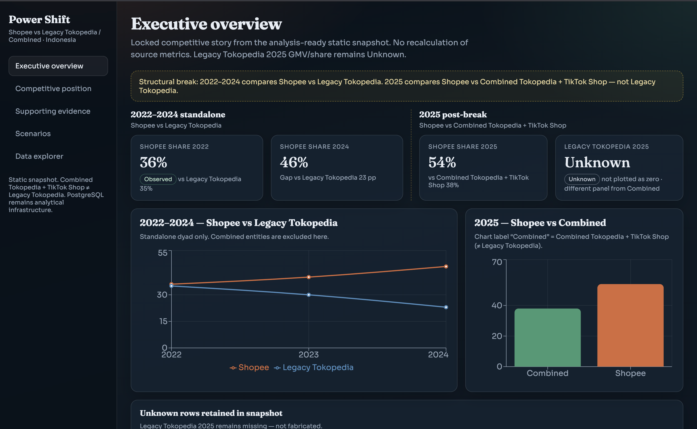
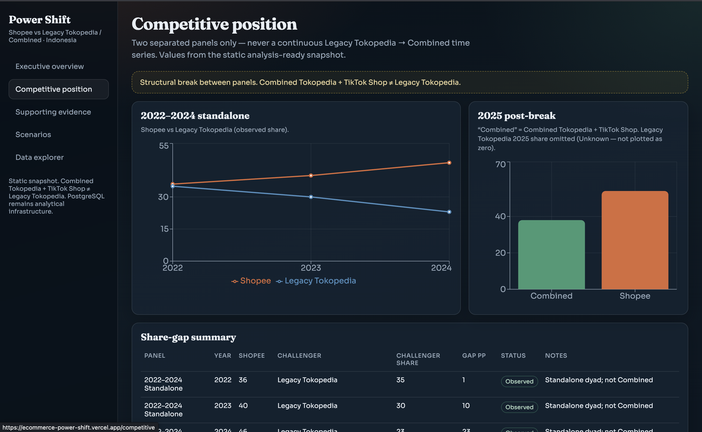
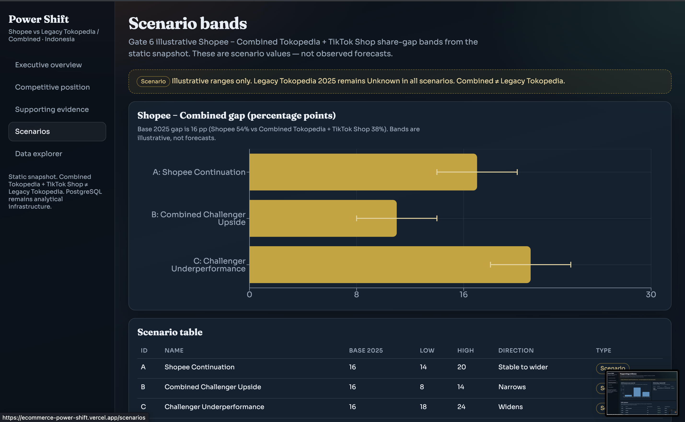
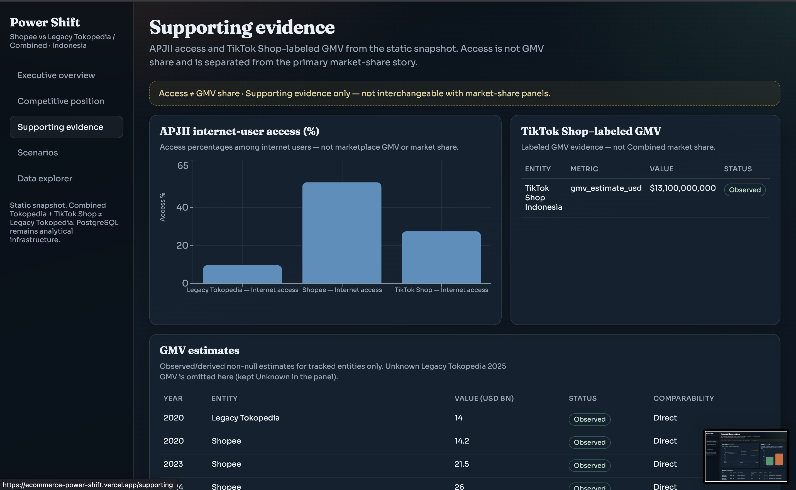
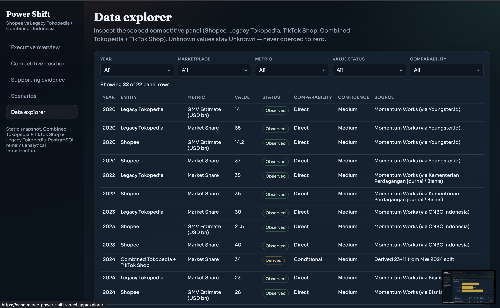

# E-Commerce Power Shift

[](https://ecommerce-power-shift.vercel.app/)
[](https://github.com/LexterMorgan/ecommerce-power-shift)

[](https://www.python.org/)
[](https://pandas.pydata.org/)
[](https://www.postgresql.org/)
[](https://www.sqlalchemy.org/)
[](https://react.dev/)
[](https://www.typescriptlang.org/)
[](https://vite.dev/)
[](https://recharts.org/)

An evidence-driven competitive analysis of **Shopee and Tokopedia-related entities in Indonesia**.

The project investigates how marketplace position changed between 2022 and 2025 while preserving the distinction between standalone Tokopedia, TikTok Shop, and the later combined entity.

The central research question is:

> How did Shopee’s competitive position in Indonesia change relative to Tokopedia, and what can the available evidence actually support?



## The short version

| Period | Shopee | Tokopedia-related entity | Interpretation |
|---|---:|---:|---|
| 2022 | 36% | Legacy Tokopedia: 35% | Comparable standalone baseline |
| 2024 | 46% | Legacy Tokopedia: 23% | Shopee widens the standalone gap |
| 2025 | 54% | Combined Tokopedia + TikTok Shop: 38% | Post-transaction comparison |
| 2025 | 54% | Legacy Tokopedia standalone: **UNKNOWN** | Not reconstructed or plotted as zero |

The most important analytical rule is:

> **Combined Tokopedia + TikTok Shop is not the same entity as Legacy Tokopedia.**

Because the market structure changed, 2025 cannot be presented as a simple continuation of the 2022–2024 standalone comparison.

## What the dashboard demonstrates

- Historical competitive-position comparison
- 2022–2024 standalone marketplace shares
- 2025 Shopee versus Combined Tokopedia + TikTok Shop
- Structural-break-aware interpretation
- Market-share and supporting evidence panels
- Access metrics kept separate from GMV metrics
- Explicit `OBSERVED`, `DERIVED`, `UNKNOWN`, and `SCENARIO` labels
- Filterable analysis by year, marketplace, metric, status, and comparability
- Static dashboard delivery without exposing database credentials

## Evidence discipline

Every analytical value is assigned an evidence status.

| Status | Meaning |
|---|---|
| `OBSERVED` | Directly reported by an identifiable source |
| `DERIVED` | Calculated from documented source values |
| `UNKNOWN` | Not supported by available evidence |
| `SCENARIO` | Illustrative range, not observed history or forecast fact |

The project intentionally does not:

- Treat missing Legacy Tokopedia 2025 data as zero
- Present Combined 2025 share as a Legacy Tokopedia comeback
- Treat platform access as equivalent to GMV
- Invent proprietary company data
- Turn scenario bands into forecasts
- Make unsupported causal claims about why one platform won

## Dashboard views

### Competitive overview



### Scenario analysis



### Supporting evidence



### Explorer



## Analytical workflow

```text
Traceable public sources
        ↓
Python cleaning and validation
        ↓
Analysis-ready datasets
        ↓
PostgreSQL and SQL views
        ↓
Validated dashboard export
        ↓
React/Vite static dashboard
```

The project uses PostgreSQL and SQL as the analytical layer, while the public dashboard consumes a version-controlled JSON snapshot.

The public UI does not require:

- A live API
- Public PostgreSQL credentials
- FastAPI hosting
- CORS configuration
- Runtime database access

## Methodology

1. Preserve traceable public sources and provenance.
2. Clean source files into canonical analytical datasets.
3. Separate 2022–2024 standalone entities from the 2025 combined structure.
4. Label every value by evidence status and comparability.
5. Validate the analytical panel and locked reference values.
6. Export a static dashboard payload for the frontend.
7. Keep unknown values null and visibly unresolved.

## Key limitations

- This is a read-only historical snapshot, not a live market-monitoring system.
- Legacy Tokopedia’s standalone 2025 GMV/share remains unknown.
- Combined Tokopedia + TikTok Shop must not be compared directly to Legacy Tokopedia without structural-break context.
- Access metrics are not GMV metrics.
- Scenario bands are illustrative and are not forecasts.
- The project does not claim causal explanations for market-share movement.
- Event and driver pages are intentionally limited to supported evidence.
- Public deployment uses a static JSON snapshot generated from the analytical layer.

## Local setup

### Analytical environment

```bash
python3 -m pip install -r requirements.txt
```

For the PostgreSQL analytical layer:

```bash
export DATABASE_URL=postgresql://localhost:5432/ecommerce_power_shift
createdb ecommerce_power_shift
python3 scripts/build_dashboard_sql.py
```

### Generate the dashboard snapshot

```bash
python3 scripts/export_dashboard_data.py
```

The generated file is written to:

```text
frontend/public/data/dashboard_data.json
```

### Run the frontend

```bash
cd frontend
npm install
npm run dev
```

Open [http://localhost:5173](http://localhost:5173).

## Validation

```bash
python3 scripts/run_gate9_validation.py
python3 scripts/check_production_readiness.py
python3 -m pytest tests/ -q
```

Frontend checks:

```bash
cd frontend
npm test
npm run build
```

## Repository structure

```text
analysis/       Exploratory analysis and chart generation
data/           Raw, processed, and dashboard-ready datasets
docs/           Data sources, availability, and project documentation
forecasting/    Scenario and competitive-evolution work
frontend/       React/Vite dashboard
python/         Reusable data preparation modules
research/       Methodology, provenance, and analytical findings
scripts/        Export, validation, and production checks
sql/            PostgreSQL schema, views, and analytical queries
tests/          Data and dashboard validation
```

## Key documentation

- [`docs/TODO.md`](docs/TODO.md) — project roadmap
- [`research/dashboard_data_contract.md`](research/dashboard_data_contract.md) — static dashboard data contract
- [`research/gate7b_dashboard_sql_schema.md`](research/gate7b_dashboard_sql_schema.md) — analytical SQL layer
- [`research/gate9_validation_report.md`](research/gate9_validation_report.md) — validation results
- [`research/gate10_deployment.md`](research/gate10_deployment.md) — deployment instructions
- [`AGENTS.md`](AGENTS.md) — repository working rules

## Project status

The analytical pipeline, PostgreSQL layer, validation checks, and static React dashboard are complete.

Remaining work is limited to optional research enhancements, manual Vercel connection, and refreshed dashboard screenshots after deployment.

Built as a portfolio market-intelligence project by [Michael Alexander](https://github.com/LexterMorgan).
